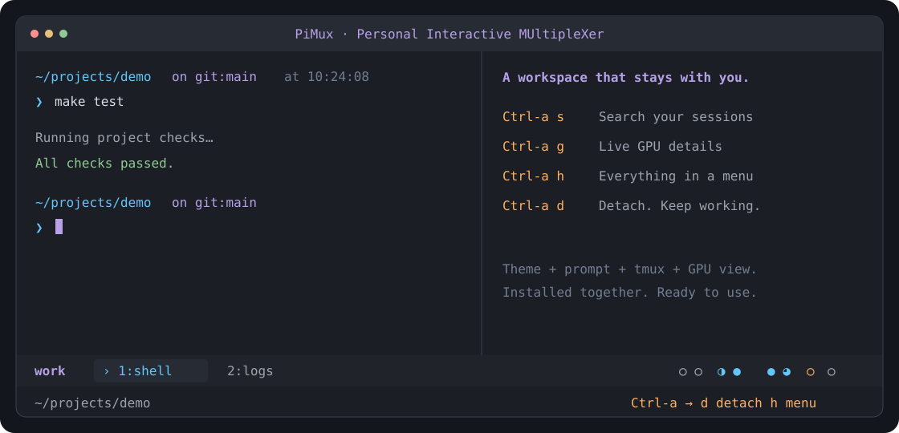

# PiMux

**Personal Interactive MUltipleXer** — a ready-to-use terminal workspace for research and project development. Built on tmux.

[简体中文](README.zh-CN.md) · [Download](https://github.com/2-mo/pimux/releases/latest) · [Changelog](CHANGELOG.md)



A coordinated purple/cyan theme, a useful shell prompt, searchable sessions and compact GPU indicators — installed together. No manual Python setup, dotfile editing or special fonts required.

## Install

On Linux:

```bash
curl -fsSL https://raw.githubusercontent.com/2-mo/pimux/main/install.sh | bash && export PATH="$HOME/.local/bin:$PATH"
```

The installer verifies the release checksum, installs missing system dependencies through apt on Debian/Ubuntu, installs or reuses [Starship](https://starship.rs/), and sets up the complete workspace in your home directory. Administrator access is only needed when system packages are missing. NVIDIA drivers are optional and are never installed by PiMux. The installer uses [uv](https://docs.astral.sh/uv/) to prepare a private Python environment for the bundled GPU dashboard, installing uv and a compatible Python when needed. It does not install packages into your research environment.

Open the installed workspace:

```bash
pimux
```

The install command enables `pimux` in this terminal immediately. The installer also configures the command path for future Bash terminals and Zsh when present, preserving your existing settings and backing up changed startup files.

Alternatively, download and extract `pimux-linux.tar.gz` from [Releases](https://github.com/2-mo/pimux/releases/latest), then run `bash pimux/setup-tmux.sh` and open a new terminal. The same installer updates an existing installation and backs up changed managed files.

## Your workspace

- **Ready-made styling.** The tmux theme and Starship prompt are enabled together. The prompt shows the current directory, Git branch, Python environment, time and slow command duration.
- **Independent window selection.** Two terminals can view different windows in the same session while sharing the running programs.
- **Search, then jump.** Window entries show the active pane’s foreground program. Open the manager, press `/`, and type a session name, window name, program or directory. Matches update as you type. Arrows select, Enter opens, Backspace edits, and Esc clears the search. Search is literal and case-insensitive.
- **Pinned sessions.** Press `p` on a manager entry, or pin the current session from `Ctrl-a h`. Pinned sessions stay at the top with a `*`; the same action unpins them. Preferences survive reconnects and recreating a session with the same name.
- **Mouse support.** Click manager entries to open them, click the left arrow to expand or collapse, and use the wheel to scroll the manager or GPU details. Mouse support is enabled automatically.
- **GPU activity at a glance.** Bold circles show approximate utilization, with four GPUs per group. Press `Ctrl-a g` for the bundled pi gpu-style dashboard: compact cards, utilization trends, memory bars and optional process details.
- **English and Chinese.** Open `Ctrl-a h`, choose `Language / 语言`, then select a language. The preference is saved automatically.
- **An isolated tmux server.** Fresh installations use their own `pimux` socket. Your normal tmux configuration is preserved. Shell startup files receive only a command-path entry. Styled shells load your existing Bash setup, then apply PiMux's prompt inside the workspace.

PiMux is a workspace inside your existing terminal or SSH connection; it is not a terminal emulator. It runs ordinary shell commands and keeps tasks alive when you detach. Closing a shared window or session ends its tasks for every connected terminal; the manager asks before doing so. Server reboots do not preserve running processes.

## Everyday commands

Start with `pimux`. Inside the workspace, `Ctrl-a h` opens the menu with management, GPU details and help; the status bar keeps this shortcut visible.

```bash
pimux                 # Session manager; never creates a session implicitly
pimux -n work         # Create or enter a named session
pimux ls              # List sessions, windows and directories
pimux ls project      # Filter the listing
pimux gpu             # Live GPU details
pimux proxy           # Proxy preferences and this shell’s actual proxy environment
pimux doctor          # Version, tmux, color and clipboard diagnostics
pimux reload          # Reload without restarting tasks
pimux update          # Install the latest release without restarting tasks
pimux --version
```

Press `Ctrl-a`, release it, then press the action key. A bright orange badge shows that PiMux is waiting for the next key, alongside common actions. Esc cancels and restores the normal status bar:

| Key | Action |
|---|---|
| `h` | Action menu |
| `s` / `w` | Session manager / current session's windows |
| `g` | GPU details; `q` or Esc returns |
| `c` / `,` | New window / rename window |
| `1`–`9` / `0` | Select a numbered window |
| `p` / `n` / `l` | Previous / next / last window |
| `L` | Previous session |
| `\|` / `-` | Split left/right / top/bottom |
| Arrow keys | Select a pane |
| `z` | Zoom or restore the pane |
| `[` / `]` | Copy mode / paste tmux's buffer |
| `P` / `y` | Full directory path / copy current path |
| `/` | Keyboard help |
| `r` / `d` | Reload / detach and leave tasks running |

In the manager, `n` creates a session with the current directory name prefilled: Enter accepts, or edit the name or clear it to cancel. `x` closes the selected item after confirmation, and `q` returns. The GPU popup refreshes every second. Click a card or use the arrows to select a GPU; the wheel moves between rows, and Page Up/Down changes pages. Press `d` for memory capacity, temperature, power and compute processes, `r` to refresh, or `q` / Esc to return. Both popups belong to the current client and do not replace another terminal's application pane.

## Network proxy

The small cyan `⛓︎` before the GPU circles appears only when the active pane's shell reports a configured proxy. Otherwise it stays hidden without reserving any space, including in older shells that have not reported yet. This indicates environment settings, not a connectivity test.

Open `Ctrl-a h` and choose **Network proxy** to set an address, enable/disable it, or inherit the shell's startup environment. Disabling remembers the address for next time. By default PiMux inherits existing settings.

```bash
pimux proxy                            # Show preferences and inherited environment
pimux proxy set http://127.0.0.1:7890    # Replace with your proxy address; enables it
pimux proxy off                        # Disable
pimux proxy on                         # Re-enable the saved address
pimux proxy reset                      # Restore the shell's startup environment
```

In an integrated PiMux Bash shell, these commands apply to subsequent commands immediately. Changes made from the menu or another terminal apply at the next prompt; press Enter if the shell is already waiting at a prompt. New PiMux windows apply the preference automatically. **For windows opened before upgrading to 0.3.0, open a new window with `Ctrl-a c` to get this integration.** Running programs keep their existing environment.

Preferences affect the standard HTTP/HTTPS/ALL proxy environment variables in PiMux Bash shells. Bypass settings (`no_proxy` / `NO_PROXY`) remain untouched. System proxy settings and external terminals are not rewritten. HTTP, HTTPS and SOCKS URLs are accepted; support depends on the command using the proxy. Status output masks authentication information, and the preference file is readable/writable only by its owner.

## GPU circles

`○ ◔ ◑ ◕  ● ○ ◑ ●`

From left to right, circles follow the machine's physical GPU order in `nvidia-smi`. They represent whole-GPU activity, not just your processes. The five fill levels represent utilization below 10%, 10–34%, 35–64%, 65–89%, and 90–100%.

- Gray: low activity and less than 256 MiB of used memory — approximately idle.
- Cyan: computation is active.
- Orange: memory is occupied but computation is low, or a query is unavailable (`?`). Waiting for data can also cause low utilization; this is not a process-health diagnosis.

The status bar refreshes on a five-second timer; window changes and other redraws may update it sooner. Without `nvidia-smi`, the circles disappear automatically. The bundled dashboard reads structured telemetry from the NVIDIA driver through `nvidia-smi`; it does not need RIPO or an installed `pi` command. Process visibility still follows driver permissions.

## Compatibility and existing tmux sessions

This release supports Linux with Bash 4+, tmux 3.2+, coreutils, grep, sed, util-linux and the `tmux-256color` terminfo entry. The installer handles dependencies on Debian/Ubuntu. On other Linux distributions, install those prerequisites using your system package manager. macOS and native Windows are not currently supported; Windows users can use a Linux environment through WSL or SSH.

For an existing system tmux session, `pimux --system ls` lists it and `pimux --system -n NAME` enters it. Detach first when switching between tmux servers. Inside an existing PiMux workspace, the plain `pimux` command automatically uses its server. Reloads update PiMux sessions; ordinary sessions keep their settings and key actions.

An optional `~/.config/pimux/runtime.conf` can select an already-installed tmux binary and a different socket. Its three lines are the primary binary's absolute path, the primary socket name, and the system binary's absolute path. This is only needed for an existing parallel tmux installation; fresh installs need no runtime file.

Choose **Copy current directory path** in `Ctrl-a h`, or press `Ctrl-a y`. The path goes into the tmux buffer and is sent only to the requesting terminal's clipboard. Clipboard transfer uses OSC 52 and depends on the outer terminal; `Ctrl-a ]` can always paste the tmux buffer. Use `pimux doctor --clipboard`, then paste into a local editor to verify. In VS Code, the terminal's normal right-click menu remains available; PiMux's menu is on `Ctrl-a h`.

## Update and uninstall

Run `pimux update`, or open `Ctrl-a h` and choose **Update PiMux**. The updater downloads the latest release, verifies its checksum, preserves language/runtime preferences and backs up changed managed files. It reloads connected workspaces without restarting tasks. The install command also works for updating older versions that do not have the update command. `pimux reload` and `Ctrl-a r` use the same reload path, including local status overrides in connected PiMux views.

```bash
pimux uninstall
```

Uninstall removes only the managed launcher. Your configuration, backups, shared Starship installation and running tasks remain. Management shortcuts need the launcher, so keep it installed while you still need those shortcuts. The standard `~/.local/bin` command-path entry stays available for your other user-installed tools.

## Development

The workspace launcher is Bash; the GPU dashboard uses Python 3.10+, Rich and Blessed. Runtime and development dependencies are locked and managed with [uv](https://docs.astral.sh/uv/). The installer keeps the GPU environment at `~/.local/share/pimux/venv`.

```bash
uv sync
uv run python -m pytest tests/test_pimux.py tests/test_gpu.py
bash scripts/package.sh
```

Tests use isolated tmux sockets. Release archives contain only the listed runtime assets and documentation. The theme and shell prompt are shipped alongside the launcher; there is no dependency on a parent project.

Licensed under [Apache-2.0](LICENSE). tmux and Starship are installed separately and retain their own licenses.
