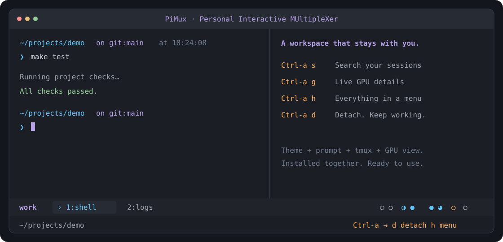

# PiMux

**Personal Interactive MUltipleXer · 个人交互式终端复用器**

面向科研实验与项目开发的个人终端工作空间，基于 tmux，开箱即用。

[English](README.md) · [下载](https://github.com/2-mo/pimux/releases/latest) · [更新记录](CHANGELOG.md)



柔紫与青蓝的终端主题、完整目录和 Git 提示符、可搜索的会话管理、轻巧的显卡圆圈，一次安装全部配好。不用手动配置 Python、修改 dotfiles 或安装特殊字体。

## 一次安装

在 Linux 服务器或终端执行：

```bash
curl -fsSL https://raw.githubusercontent.com/2-mo/pimux/main/install.sh | bash && export PATH="$HOME/.local/bin:$PATH"
```

安装器下载并校验发布包，在 Debian/Ubuntu 上通过 apt 补齐缺失的系统依赖，安装或复用 Starship，并将整套工具放入用户目录。仅当系统依赖缺失时需要管理员权限；不会安装显卡驱动。安装器通过 uv 自动准备显卡界面的独立 Python 环境，缺少 uv 或兼容的 Python 时也会自动安装，不向科研项目环境安装依赖。

安装后进入：

```bash
pimux
```

上面的安装命令会让当前终端立即识别 `pimux`。安装器也会为之后打开的 Bash 终端、以及已有的 Zsh 配好命令路径，保留原有设置，修改启动文件前先备份。

也可以从 [Releases](https://github.com/2-mo/pimux/releases/latest) 下载并解压 `pimux-linux.tar.gz`，运行 `bash pimux/setup-tmux.sh` 后打开新终端。更新时重新运行相同安装命令，已有的受管文件发生变化时先备份。

## 默认就有

- **统一外观**：终端栏和 Starship 提示符一起启用，展示目录、Git 分支、Python 环境、时间与慢命令耗时。
- **独立切换窗口**：两个终端可以进入同一会话的不同窗口，共享运行中的程序，不互相抢当前窗口。
- **会话搜索**：管理列表展示窗口当前的前台程序，按 `/` 可按名称、程序或目录实时筛选。方向键选择、Enter 直接进入、Backspace 删除输入、Esc 清空。搜索不区分大小写，按字面匹配。
- **常用会话置顶**：管理列表选中条目后按 `p`，或通过 `Ctrl-a h` 菜单置顶当前会话。置顶项带 `*` 并排在前面，再操作一次取消；重新连接或重建同名会话后仍会保留。
- **鼠标操作**：点击管理列表条目直接进入，点左侧箭头展开或收起，滚轮翻动列表和显卡详情，默认开启。
- **显卡概况与详情**：圆圈表示大概利用率，每四张卡一组；`Ctrl-a g` 打开内置的 pi gpu 同款界面，展示显卡卡片、利用率曲线、显存条和进程详情，`q` 返回。
- **中英切换**：`Ctrl-a h` 打开菜单，选择 `Language / 语言`。偏好会自动保存。
- **独立工作空间**：首次安装默认使用自己的 tmux 服务，保留原有 `.tmux.conf`；shell 启动文件只追加命令路径。PiMux 内的 Bash 会加载用户原设置，然后应用自带提示符。

PiMux 在现有终端或 SSH 连接中工作，不是终端模拟器。离开连接会保留任务；关闭共享窗口或会话会影响所有连接，管理列表会要求确认。机器重启后不能恢复原进程。

## 日常使用

记住 `pimux` 就能进入。进入后用 `Ctrl-a h` 打开菜单，管理、显卡详情和帮助都在里面；状态栏会一直提示这个入口。

```bash
pimux                 # 管理列表，不自动新建会话
pimux -n work         # 创建或进入命名会话
pimux ls              # 列出会话、窗口和目录
pimux ls project      # 筛选列表
pimux gpu             # 显卡详情
pimux ports           # 端口、占用进程和工作目录；也可加端口号
pimux proxy           # 打开代理设置面板
pimux doctor          # 版本、颜色、剪贴板诊断
pimux reload          # 热重载，不重启任务
pimux update          # 更新到最新版，保留运行中的任务
pimux --version
```

先按 `Ctrl-a` 并松开，再按操作键。等待按键时，状态栏会显示亮橙底深色字的提示块和常用操作；按 Esc 取消并恢复平时的状态栏：

| 键 | 操作 |
|---|---|
| `h` | 操作菜单 |
| `s` / `w` | 管理列表 / 当前会话窗口列表 |
| `g` | 显卡详情，`q` 或 Esc 返回 |
| `c` / `,` | 新建窗口 / 重命名 |
| `1`–`9` / `0` | 选择窗口 |
| `p` / `n` / `l` | 上一个 / 下一个 / 上次使用的窗口 |
| `L` | 上次使用的会话 |
| `\|` / `-` | 左右 / 上下分屏 |
| 方向键 | 选择 pane |
| `z` | 放大 / 恢复 pane |
| `[` / `]` | 复制模式 / 粘贴 tmux 缓冲区 |
| `P` / `y` | 查看完整路径 / 复制当前路径 |
| `/` | 快捷键帮助 |
| `r` / `d` | 重载 / 离开并保留任务 |

管理列表中按 `n` 新建，默认填入当前目录名；Enter 接受，也可修改或清空取消。`x` 关闭选中项（需确认），`q` 返回。显卡弹窗每秒刷新；点击卡片或按方向键选卡，滚轮切换行，Page Up/Down 翻页。`d` 展开显存容量、温度、功耗和计算进程。详情保留完整进程路径，并在当前 Linux 用户权限允许时显示启动命令与工作目录；长内容自动换行，滚轮或 Page Up/Down 滚动查看全部详情，方向键仍用于选卡。`r` 立即刷新，`q` / Esc 返回。管理列表和显卡详情只在当前客户端弹出，不占用其他终端的应用 pane。

## 端口与窗口预览

`Ctrl-a h → 端口查看` 或 `pimux ports` 显示本机 TCP 监听地址、占用进程、启动命令和工作目录。按 `/` 输入端口、进程名或目录筛选；Enter 结束输入，Esc 清空搜索。也可用 `pimux ports 8888` 精确查看一个端口。读取范围由系统权限决定；这里只显示服务器监听情况，不代表服务健康或本机转发地址。

管理列表中选中窗口后按 `d`，可查看各 pane 的空闲／进程存活状态、工作目录和最近 60 行输出；选中会话时预览其当前窗口。已退出 pane 若被 tmux 保留，会显示退出码。预览每 3 秒刷新，滚轮或方向键滚动，`q` / Esc 回到管理列表，保留原选中项。查看不会切换其他客户端的窗口或向程序发送按键。

## 网络代理

只有当前分屏的 shell 上报已配置代理时，显卡圆圈前才显示青色 `⛓︎`。未配置或尚未上报的旧 shell 都隐藏图标，不留空位。它反映环境配置，不表示网络连通性检测结果。

运行 `pimux proxy`，或打开 `Ctrl-a h → 网络代理`。面板分别显示 PiMux 设置、当前终端报告的代理状态和保存的地址。方向键选择、Enter 确认，也可直接点击操作；停用会保留地址，使用启动环境会恢复每个 shell 原来的设置。

按 `e` 在原界面编辑地址，支持直接输入 `127.0.0.1:7890`。Enter 保存并启用，Esc 取消，Ctrl-u 清空；无效地址会就地提示。认证信息在显示和编辑时均遮蔽。尚未报告的终端显示为“尚未报告”，不会把保存设置当作已生效。

```bash
pimux proxy                            # 打开设置面板
pimux proxy show                       # 输出设置及当前终端传入的环境
pimux proxy set http://127.0.0.1:7890    # 换成自己的代理地址，同时启用
pimux proxy off                        # 停用
pimux proxy on                         # 重新启用保存的地址
pimux proxy reset                      # 恢复 shell 的启动环境
```

在已集成的 PiMux Bash 中，这些命令会立即对后续命令生效。通过菜单或其他终端修改后，会在下次提示符应用；已停在 shell 提示符时按一次 Enter 即可。新窗口自动应用设置。**0.3.0 之前打开、尚未集成代理功能的旧窗口，需要用 `Ctrl-a c` 新开窗口。** 已运行的程序保持原环境。

代理控制 PiMux Bash 中标准的 HTTP/HTTPS/ALL 代理环境变量，保留 `no_proxy` / `NO_PROXY` 绕过规则，不改写系统代理和外部终端。接受 HTTP、HTTPS 和 SOCKS 地址，具体支持由使用代理的命令决定。状态输出隐藏认证信息，设置文件仅本人可读写。

## 显卡圆圈

`○ ◔ ◑ ◕  ● ○ ◑ ●`

从左到右对应 `nvidia-smi` 的物理卡顺序，反映整张卡的负载。填充程度依次表示 `<10%`、`10–34%`、`35–64%`、`65–89%`、`90–100%` 利用率。

- 灰色：计算很低且显存使用低于 256 MiB，大致空闲。
- 青色：正在计算。
- 橙色：显存已占用但计算很低；读取不可用时显示 `?`。

等待数据也可能使利用率很低，圆圈不能单独判断程序故障。状态栏每五秒定时刷新，切换窗口等重绘也可能提前更新。没有 `nvidia-smi` 时自动隐藏圆圈；内置界面通过 `nvidia-smi` 读取驱动的结构化数据，不需要 RIPO 或已有的 `pi` 命令。进程可见范围仍由驱动和权限决定。

## 环境和已有会话

支持 Linux，要求 Bash 4+、tmux 3.2+、coreutils、grep、sed、util-linux，以及 `tmux-256color` terminfo。Debian/Ubuntu 上由安装器补齐；其他 Linux 发行版通过系统包管理器安装这些依赖。暂不支持 macOS 或原生 Windows；Windows 可通过 WSL 的 Linux 环境或 SSH 使用。

`pimux --system ls` 查看系统 tmux 会话，`pimux --system -n NAME` 进入已有会话。跨服务切换前先离开当前连接。已在 PiMux 工作空间内时，直接运行 `pimux` 会自动使用当前服务。重载会更新 PiMux 会话，普通会话保留原设置和按键行为。

已有并行 tmux 安装可以在 `~/.config/pimux/runtime.conf` 指定主程序绝对路径、主 socket 名称、系统程序绝对路径，每项一行。首次安装不需要这个文件。

通过 `Ctrl-a h → 复制当前目录路径` 或 `Ctrl-a y` 复制路径，会写入 tmux 缓冲区，并只发送给触发操作的那个终端。系统剪贴板采用 OSC 52，实际支持取决于外层终端；也可以用 `Ctrl-a ]` 粘贴 tmux 缓冲区。用 `pimux doctor --clipboard` 后在本地编辑器粘贴验证。VS Code 原有的右键菜单保留，PiMux 菜单用 `Ctrl-a h` 打开。

## 更新与卸载

运行 `pimux update`，或者通过 `Ctrl-a h` 菜单选择“更新 PiMux”。更新器下载最新发布包并校验，保留语言和运行配置，变化的受管文件会先备份；更新后自动重载当前工作空间，运行中的任务保留。尚无更新命令的旧版本，重新运行一次安装命令即可升级。`pimux reload` 与 `Ctrl-a r` 使用相同的重载路径，也会更新已连接视图中的局部状态栏配置。

```bash
pimux uninstall
```

卸载只移除受管的命令入口，保留设置、备份、共用的 Starship 安装和正在运行的任务。管理快捷键依赖命令入口，仍需要这些快捷键时请保留安装。标准的 `~/.local/bin` 命令路径会保留，方便其他用户级工具继续使用。

## 开发

终端入口使用 Bash；显卡界面使用 Python 3.10+、Rich 和 Blessed，运行及开发依赖均由 uv 锁定管理。安装器将显卡运行环境放在 `~/.local/share/pimux/venv`：

```bash
uv sync
uv run python -m pytest tests/test_pimux.py tests/test_gpu.py tests/test_views.py
bash scripts/package.sh
```

测试使用隔离的 tmux socket。发布包只包含明确列出的运行文件与文档，不依赖其他项目。

采用 [Apache-2.0](LICENSE) 许可证；tmux 和 Starship 独立安装，保留各自的许可证。
