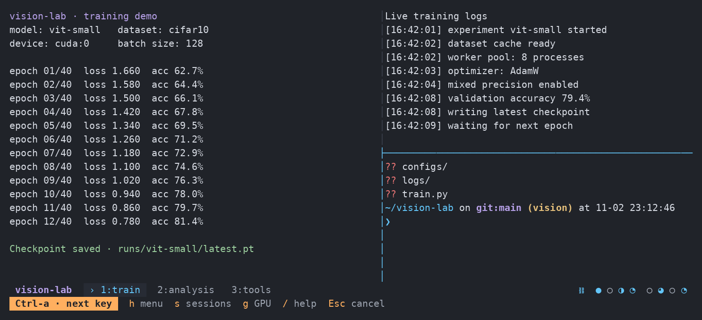
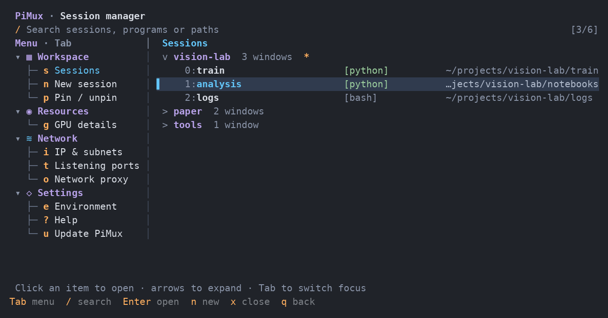
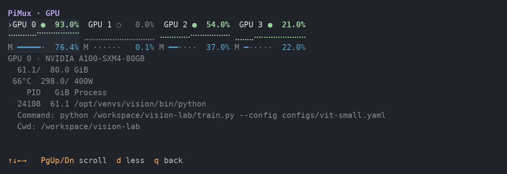
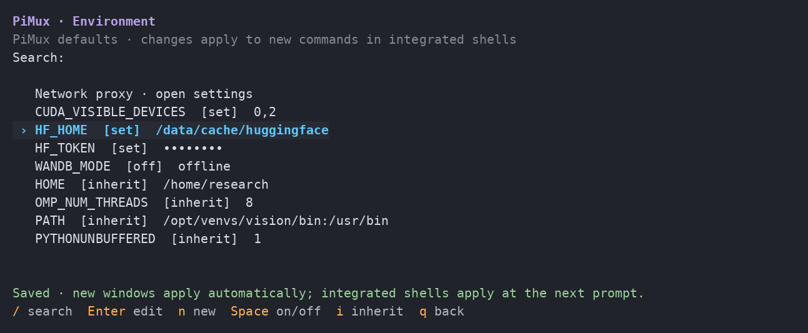
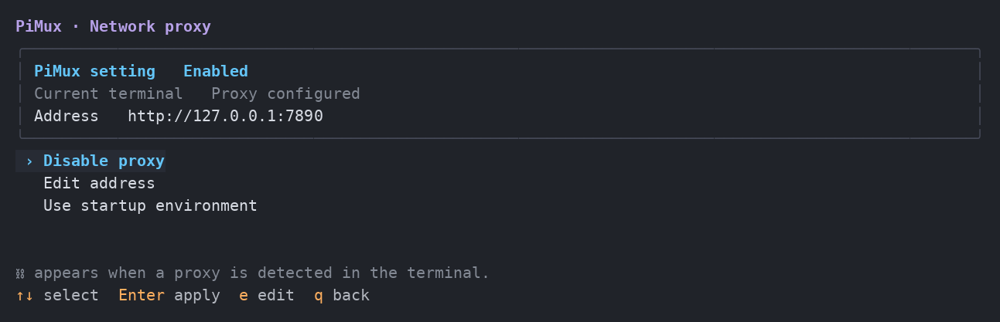

# PiMux

面向科研与项目开发的 tmux 工作台。

[English](../README.md)



## 安装 · Linux

```bash
curl -fsSL https://raw.githubusercontent.com/2-mo/pimux/main/install.sh | bash && export PATH="$HOME/.local/bin:$PATH"
```

Debian/Ubuntu 会自动补齐 tmux 等终端依赖。

## 安装 · macOS 测试版

PiMux **1.0.0-beta.1** 是面向 Apple silicon、macOS 15 及以上的预发布版本。Linux **v0.11.0** 仍是稳定版 / latest；上面的 Linux 安装命令不安装 Mac 测试版。

```sh
brew tap 2-mo/pimux https://github.com/2-mo/pimux
brew trust --formula 2-mo/pimux/pimux-preview
brew install 2-mo/pimux/pimux-preview
pimux
```

[Mac 测试版](macos.md) 提供本机终端和本机检查工具，以及实验性的[多服务器 CLI 单次快照](hosts.md)，可读取 VS Code/OpenSSH 别名。公钥授权需明确确认。统一多服务器 TUI 和远端会话进入/管理尚未实现；Intel Mac 尚未验证。

Mac GPU 页面显示原生芯片型号和核心数；只有驱动提供有效计数时才显示利用率。共享统一内存不会标为独立显存，温度、功耗和逐进程 GPU 内存等不可用指标不会填成零。

## 使用

```bash
pimux
```

- 按 `n` 新建会话；`/` 按项目、程序或目录搜索分屏，Enter 直达。
- 通过树形菜单找到**显卡、IP、端口、代理和设置**；`Tab` 切换区域，`q` 返回。
- 进入会话后，先按并松开 `Ctrl-a`，再按 `-` 上下分屏、`v` 左右分屏、`h` 打开菜单、`d` 离开并保留任务。
- 让 agent 通过 `pimux tmux` 自行组织实验窗口：[后台管理说明](agents.zh-CN.md)。

## 终端明暗主题

无法判断背景时，PiMux 使用终端自身的默认字色，浅色和深色终端都能保持可读。`auto` 在 tmux 外可参考 `COLORFGBG` 调色板提示，但这不是精确的背景检测；tmux 内会忽略可能从其他客户端继承的提示。主题检测不发送终端查询，也不读取键盘输入。

- `pimux theme`：查看当前模式、实际配色和来源。
- `pimux theme light` / `pimux theme dark`：保存浅色 / 深色配色；`pimux theme auto` 恢复自动模式。
- `PIMUX_THEME=light pimux`：仅为本次进程覆盖已保存的设置，也支持 `auto` / `dark`。

设置保存在 `~/.config/pimux/theme`。重新打开管理页或弹窗即可应用，不重启会话和任务。管理页、GPU 和其他工具页共用主题；`NO_COLOR` 下保留选中提示。tmux 状态栏继续使用前景与深色背景成对的配色。

## 更新

Linux：

```bash
pimux update
```

Mac 测试版使用 `brew update && brew upgrade 2-mo/pimux/pimux-preview` 更新，使用 `brew uninstall 2-mo/pimux/pimux-preview` 卸载。运行时和会话注意事项见 [Mac 指南](macos.md)。

## 看看怎么用

演示工作区与示例显卡数据。

**按项目、程序或目录找窗口，常用工具集中在树形菜单。**



**快速找空卡，查看显存与完整进程命令。**



**统一设置环境变量，敏感值默认遮蔽。**



**在一个页面开启、关闭或修改代理。**



[完整说明](guide.zh-CN.md) · [更新记录](CHANGELOG.md) · [Apache-2.0](../LICENSE)
