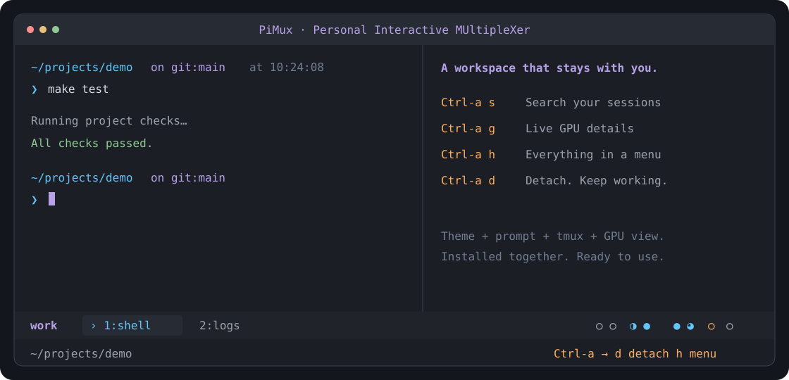

# PiMux guide

[简体中文](guide.zh-CN.md) · [Quick start](../README.md)



## Installation details

The installer verifies the release checksum, installs missing system dependencies through apt on Debian/Ubuntu, installs or reuses [Starship](https://starship.rs/), and sets up the complete workspace in your home directory. Administrator access is only needed when system packages are missing. NVIDIA drivers are optional and are never installed by PiMux. The installer uses [uv](https://docs.astral.sh/uv/) to prepare a private Python environment for the bundled GPU dashboard, installing uv and a compatible Python when needed. It does not install packages into your research environment.

The install command enables `pimux` in this terminal immediately. The installer also configures the command path for future Bash terminals and Zsh when present, preserving your existing settings and backing up changed startup files.

Alternatively, download and extract `pimux-linux.tar.gz` from [Releases](https://github.com/2-mo/pimux/releases/latest), then run `bash pimux/scripts/setup-tmux.sh` and open a new terminal. The same installer updates an existing installation and backs up changed managed files.

## Your workspace

- **Ready-made styling.** The tmux theme and Starship prompt are enabled together. The prompt shows the current directory, Git branch, Python environment, time and slow command duration.
- **Independent window selection.** Two terminals can view different windows in the same session while sharing the running programs.
- **Search, then jump.** Window entries show the active pane’s foreground program. Open the manager, press `/`, and type a session name, window name, program or directory. Matches update as you type. Arrows select, Enter opens, Backspace edits, and Esc clears the search. Search is literal and case-insensitive.
- **Pinned sessions.** Press `p` on a manager entry, or pin the current session from `Ctrl-a h`. Pinned sessions stay at the top with a `*`; the same action unpins them. Preferences survive reconnects and recreating a session with the same name.
- **Mouse support.** Click manager entries to open them, click the left arrow to expand or collapse, and use the wheel to scroll the manager or GPU details. Mouse support is enabled automatically.
- **GPU activity at a glance.** Bold circles show approximate utilization, with four GPUs per group. Press `Ctrl-a g` for the bundled pi gpu-style dashboard: compact cards, utilization trends, memory bars and optional process details.
- **English and Chinese.** Open `Ctrl-a h`, choose `Language / 语言`, then select a language. The preference is saved automatically.
- **An isolated tmux server.** Fresh installations use their own `pimux` socket. Your normal tmux configuration is preserved. Shell startup files receive only a command-path entry. Styled shells load your existing Bash setup, then apply PiMux's prompt inside the workspace.

PiMux is a workspace inside your existing terminal or SSH connection; it is not a terminal emulator. It runs ordinary shell commands and keeps tasks alive when you detach. Closing a shared window or session ends its tasks for every connected terminal; the manager asks before doing so. Server reboots do not preserve running processes.

## Everyday commands

Start with `pimux`. The main interface has clickable **Env, Proxy, GPU, Ports, IP and Help** entries at the top, with visible e / o / g / t / i / ? keys. Press `q` to return to the same session selection and search. The commands below are optional shortcuts. Inside a workspace, `Ctrl-a h` also opens the action menu.

```bash
pimux                 # Session manager; never creates a session implicitly
pimux -n work         # Create or enter a named session
pimux ls              # List sessions, windows and directories
pimux ls project      # Filter the listing
pimux gpu             # Live GPU details
pimux ports           # Listeners, processes and directories; optionally add a port
pimux env             # Environment defaults, including the proxy shortcut
pimux proxy           # Open proxy settings directly
pimux help            # Searchable help
pimux doctor          # Version, tmux, color and clipboard diagnostics
pimux reload          # Reload without restarting tasks
pimux update          # Install the latest release without restarting tasks
pimux --version
```

`pimux help` or `Ctrl-a /` opens searchable help from the actual bindings. Help, paths and detail views use the same bottom action bar; `q` / Esc returns.

Press `Ctrl-a`, release it, then press the action key. A bright orange badge shows that PiMux is waiting for the next key, alongside common actions. Esc cancels and restores the normal status bar:

| Key | Action |
|---|---|
| `h` | Action menu |
| `s` / `w` | Session manager / current session's windows |
| `g` | GPU details; `q` or Esc returns |
| `c` / `,` | New window / rename window |
| `1`–`9` / `0` | Select a numbered window |
| `p` / `n` / `l` | Previous / next / last window |
| `L` | Previous session |
| `\|` / `-` | Split left/right / top/bottom |
| Arrow keys | Select a pane |
| `z` | Zoom or restore the pane |
| `x` | Close the selected pane and its programs, after confirmation |
| `[` / `]` | Copy mode / paste tmux's buffer |
| `P` / `y` | Full directory path / copy current path |
| `/` | Keyboard help |
| `r` / `d` | Reload / detach and leave tasks running |

In the manager, `n` creates a session with the current directory name prefilled: Enter accepts, or edit the name or clear it to cancel. `x` closes the selected item after confirmation, and `q` returns. The GPU popup refreshes every second. Click a card or use the arrows to select a GPU; the wheel moves between rows, and Page Up/Down changes pages. Press `d` for memory capacity, temperature, power and compute processes. Expanded details retain full process paths and show launch commands and working directories when visible to your Linux user. Long lines wrap, and the wheel or Page Up/Down scrolls through all details; arrows still select GPUs. Press `r` to refresh or `q` / Esc to return. Both popups belong to the current client and do not replace another terminal's application pane.

## IP addresses and subnet routes

Choose **IP** in the main interface, press `i`, or use `pimux ip`. The page shows each interface's IPv4/IPv6 addresses and CIDR subnets, plus default and subnet routes with their device, gateway and routing table. Multiple addresses on one interface and policy routing tables remain distinct.

When available, [Tailscale's local status](https://tailscale.com/docs/reference/tailscale-cli#status) adds this device's addresses and MagicDNS name, including userspace mode. The page does not require Tailscale to be installed. Press `a` to toggle loopback, container and link-local interfaces, `/` to filter, and the wheel or PgUp/PgDn to scroll. Local information refreshes every three seconds. `pimux ip --all --once` prints all interfaces.

Press `p` to request the public egress IP from [ipify](https://www.ipify.org/), with a three-second request limit. This query bypasses HTTP/SOCKS proxies and follows the current system route. Opening the page or refreshing local information does not query that service. The terminal's proxy state or saved PiMux preference is labelled separately.

## Ports and window previews

Choose **Ports** in the main `pimux` interface to inspect local TCP listeners, owning processes, commands and working directories. The optional `pimux ports` shortcut and **Listening ports** in `Ctrl-a h` remain available. Press `/` to filter by port, process or directory; Enter finishes typing and Esc clears the search. Use `pimux ports 8888` for an exact port lookup. Visibility follows system permissions. These are server listeners, not a service health check or your local forwarded addresses.

In the manager, select a window and press `d` to preview each pane's idle/alive state, working directory and last 60 lines of output. Selecting a session previews its current window. Exit codes are available for exited panes retained by tmux. Previews refresh every three seconds; scroll with the wheel or arrows, and use `q` / Esc to return to the same manager selection. Inspection does not change another client's selected window or send keys to applications.

## Environment defaults

Choose **Env** in the main `pimux` interface, use the optional `pimux env` shortcut, or choose **Environment** from `Ctrl-a h`. The list distinguishes saved defaults, disabled entries and inherited values; Network proxy stays at the top as a shortcut. Press `/` to search names, Enter to view/edit, `n` to add, Space to enable/disable and `i` to restore inheritance. While editing, Enter saves, Esc cancels and F2 reveals or masks the value.

Settings are **PiMux-wide defaults**. New PiMux windows apply them automatically, and integrated Bash shells apply changes at the next prompt. Commands such as `pimux env set/on/off/reset` apply immediately to subsequent commands in an integrated shell. Older windows need a new shell: return and press `Ctrl-a c`; the panel explains when this is needed. Running programs retain their original environment.

```bash
pimux env set HF_HOME /data/models    # Save and export a literal value
pimux env off HF_HOME                # Unset it, keeping the saved value
pimux env on HF_HOME                 # Re-enable the saved value
pimux env reset HF_HOME              # Restore each shell's inherited value/export state
pimux env show HF                    # Print matching variables with sensitive values masked
```

Values are literal text, may be empty, and never evaluate shell expressions such as `$()` or `$VAR`. Unchanged defaults do not repeatedly overwrite manual exports. Variables maintained by the shell, tmux or environment tools, such as PATH and HOME, are visible but read only. Proxy addresses use the dedicated proxy entry; `no_proxy` / `NO_PROXY` may be set separately here. Settings live in `~/.config/pimux/environment.json` with owner-only access. Token/password variables are masked by default.

A menu-opened page reads inherited values from the foreground process's startup environment. A direct command can also inspect the environment it received. Saved defaults are distinguished from running-program values.

## Network proxy

The small cyan `⛓︎` before the GPU circles appears when a proxy is detected in the active pane. PiMux uses the shell's report first. In older panes without a report, it reads the foreground process's startup environment on the five-second status refresh. With no proxy or unreadable process information, the icon stays hidden without reserving space. This indicates environment settings, not a connectivity test.

Choose **Proxy** in the main `pimux` interface, use the optional `pimux proxy` shortcut, or choose **Network proxy** from `Ctrl-a h`. The panel separates PiMux preferences, the current terminal's reported proxy state and the saved address. Select with arrows and Enter, or click an action. Disabling keeps the address; using the startup environment restores each shell's original settings.

Press `e` to edit inline. A short address such as `127.0.0.1:7890` is accepted. Enter saves and enables it, Esc cancels, and Ctrl-u clears the field. Invalid addresses show an inline error. Authentication is masked in both display and editing. For older panes, the panel labels detected settings as coming from the foreground process. A saved preference alone never marks a terminal as active. Process inspection sees the startup environment; later manual changes inside an older shell become visible when it starts a new foreground command, or after opening an integrated PiMux window.

```bash
pimux proxy                            # Open the settings panel
pimux proxy show                       # Print preferences and inherited environment
pimux proxy set http://127.0.0.1:7890    # Replace with your proxy address; enables it
pimux proxy off                        # Disable
pimux proxy on                         # Re-enable the saved address
pimux proxy reset                      # Restore the shell's startup environment
```

In an integrated PiMux Bash shell, these commands apply to subsequent commands immediately. Changes made from the menu or another terminal apply at the next prompt; press Enter if the shell is already waiting at a prompt. New PiMux windows apply the preference automatically. **For windows opened before upgrading to 0.3.0, open a new window with `Ctrl-a c` to get this integration.** Running programs keep their existing environment.

Preferences affect the standard HTTP/HTTPS/ALL proxy environment variables in PiMux Bash shells. Bypass settings (`no_proxy` / `NO_PROXY`) remain untouched. System proxy settings and external terminals are not rewritten. HTTP, HTTPS and SOCKS URLs are accepted; support depends on the command using the proxy. Status output masks authentication information, and the preference file is readable/writable only by its owner.

## GPU circles

`○ ◔ ◑ ◕  ● ○ ◑ ●`

From left to right, circles follow the machine's physical GPU order in `nvidia-smi`. They represent whole-GPU activity, not just your processes. The five fill levels represent utilization below 10%, 10–34%, 35–64%, 65–89%, and 90–100%.

- Gray: low activity and less than 256 MiB of used memory — approximately idle.
- Cyan: computation is active.
- Orange: memory is occupied but computation is low, or a query is unavailable (`?`). Waiting for data can also cause low utilization; this is not a process-health diagnosis.

The status bar refreshes on a five-second timer; window changes and other redraws may update it sooner. Without `nvidia-smi`, the circles disappear automatically. The bundled dashboard reads structured telemetry from the NVIDIA driver through `nvidia-smi`; it does not need RIPO or an installed `pi` command. Process visibility still follows driver permissions.

## Compatibility and existing tmux sessions

This release supports Linux with Bash 4+, tmux 3.2+, coreutils, grep, sed, util-linux and the `tmux-256color` terminfo entry. The installer handles dependencies on Debian/Ubuntu. On other Linux distributions, install those prerequisites using your system package manager. macOS and native Windows are not currently supported; Windows users can use a Linux environment through WSL or SSH.

For an existing system tmux session, `pimux --system ls` lists it and `pimux --system -n NAME` enters it. Detach first when switching between tmux servers. Inside an existing PiMux workspace, the plain `pimux` command automatically uses its server. Reloads update PiMux sessions; ordinary sessions keep their settings and key actions.

An optional `~/.config/pimux/runtime.conf` can select an already-installed tmux binary and a different socket. Its three lines are the primary binary's absolute path, the primary socket name, and the system binary's absolute path. This is only needed for an existing parallel tmux installation; fresh installs need no runtime file.

Choose **Copy current directory path** in `Ctrl-a h`, or press `Ctrl-a y`. The path goes into the tmux buffer and is sent only to the requesting terminal's clipboard. Clipboard transfer uses OSC 52 and depends on the outer terminal; `Ctrl-a ]` can always paste the tmux buffer. Use `pimux doctor --clipboard`, then paste into a local editor to verify. In VS Code, the terminal's normal right-click menu remains available; PiMux's menu is on `Ctrl-a h`.

## Update and uninstall

Run `pimux update`, or open `Ctrl-a h` and choose **Update PiMux**. The updater downloads the latest release, verifies its checksum, preserves language/runtime preferences and backs up changed managed files. It reloads connected workspaces without restarting tasks. The install command also works for updating older versions that do not have the update command. `pimux reload` and `Ctrl-a r` use the same reload path, including local status overrides in connected PiMux views.

```bash
pimux uninstall
```

Uninstall removes only the managed launcher. Your configuration, backups, shared Starship installation and running tasks remain. Management shortcuts need the launcher, so keep it installed while you still need those shortcuts. The standard `~/.local/bin` command-path entry stays available for your other user-installed tools.

## Development

Runtime and development dependencies use [uv](https://docs.astral.sh/uv/). The launcher is Bash; interactive views use Python 3.10+, Rich and Blessed. The installed Python environment is at `~/.local/share/pimux/venv`.

Source layout: `lib/` holds runtime modules, `config/` holds themes, `scripts/` holds packaging and removal tools, and `docs/screenshots/` holds README captures. `bin/pimux` is the source launcher; `scripts/setup-tmux.sh` installs a local checkout. The root `install.sh` is the stable public download entry. The translated quick start and changelog live in `docs/`.

```bash
uv sync
bash scripts/package.sh
```

Run the test file relevant to a behavior change; documentation-only edits need no tests. Tests use isolated tmux sockets. CI runs on main and pull requests, skips documentation-only changes and tags, and cancels superseded runs.

Release archives contain runtime modules, configuration and user documentation. PiMux has no dependency on a parent project.

Licensed under [Apache-2.0](../LICENSE). tmux and Starship are installed separately and retain their own licenses.
